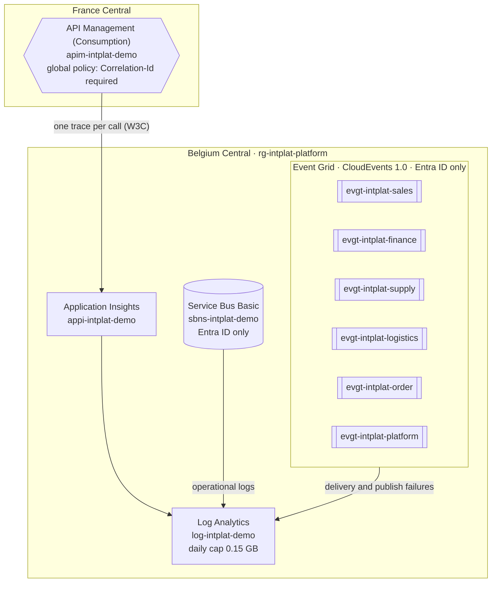
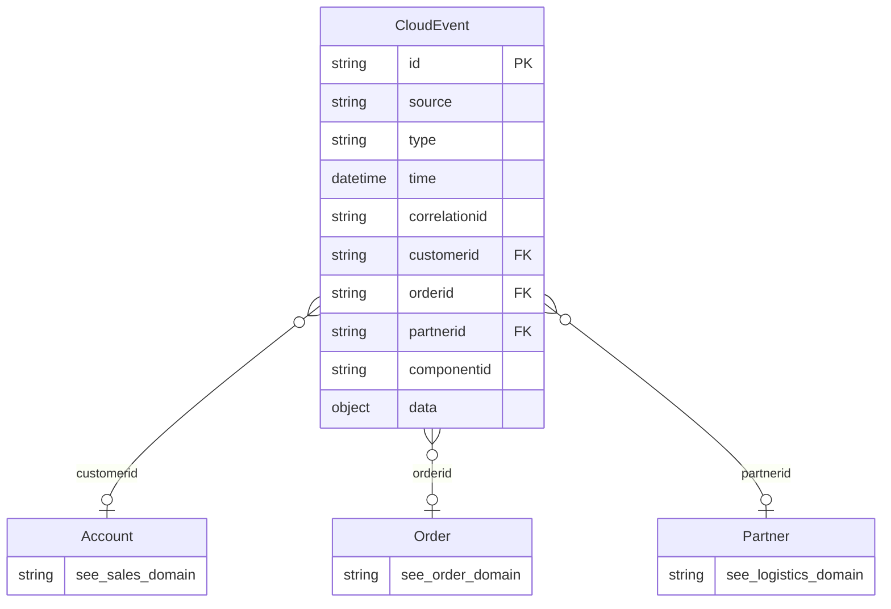
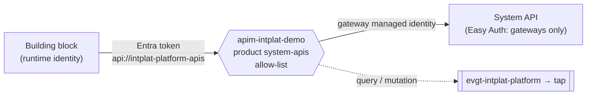

# integration-platform

The shared foundation of the
[AI Intelligence Domain demo](https://github.com/azure-intelligence-domain/ai-intelligence-domain)
integration platform. Owned by the **platform team**. Decisions: [ADR 0010](https://github.com/azure-intelligence-domain/ai-intelligence-domain/blob/main/docs/adr/0010-platform-core.md)
(platform core), [ADR 0011](https://github.com/azure-intelligence-domain/ai-intelligence-domain/blob/main/docs/adr/0011-tap-by-default.md)
(tap by default), [ADR 0012](https://github.com/azure-intelligence-domain/ai-intelligence-domain/blob/main/docs/adr/0012-agent-gateway.md)
(agent gateway), [ADR 0014](https://github.com/azure-intelligence-domain/ai-intelligence-domain/blob/main/docs/adr/0014-process-layer-split.md)
(routing as configuration, internal calls).

| Resource | Name | Notes |
|---|---|---|
| API Management | `apim-intplat-demo` | Consumption tier, France Central (not offered in Belgium Central). Every call traced to Application Insights with W3C correlation; `Correlation-Id` logged; client IPs not logged. |
| Event Grid topics | `evgt-intplat-<domain>` | One per business domain, CloudEvents 1.0 input schema, local auth disabled. |
| Service Bus | `sbns-intplat-demo` | Basic tier; one queue per subscriber (added with each consumer), local auth disabled. |
| Application Insights | `appi-intplat-demo` | Workspace-based. |
| Log Analytics | `log-intplat-demo` | 30-day retention, **daily cap 0.15 GB** (within the free 5 GB per month). |

## Two gateways

| Gateway | For | Login | Tapped |
|---|---|---|---|
| `apim-intplat-demo` | Staff in the customer portal (products `webshop`, `customer-service`, `partners`); building blocks (`process-apis`, `system-apis`) | Staff: a Google ID token of a `thevaluehub.be` account (ADR 0017); building blocks: an Entra token of an allowed runtime identity. No subscription keys | Every query (GET) and mutation (POST, PUT, PATCH, DELETE), with business keys and who called |
| `apim-intplat-agents` | AI agents | Entra ID token of an agent with `Agent.Act`, plus subscription key; 60 calls/min | Every call, with the agent's identity and business keys |

Tapped calls carry the business keys found in the request as CloudEvent attributes: parameter
`orderId` becomes `orderid`, `customerId` becomes `customerid` (ADR 0013). So "ACME's order 4711 was
retrieved 5 times today" is a count over the tap. Each one also says who called (`data.principal`:
the staff member's e-mail, or the building block's application id).

| Product (people gateway) | APIs | Who gets in |
|---|---|---|
| `webshop`, `customer-service`, `partners` | The Experience APIs | Staff signed in with Google ([`staff.yaml`](routing/staff.yaml)); allow-listed building blocks (the journey test). Else [`401 Staff Sign-In Required`](docs/problems/staff-sign-in-required.md) |
| `process-apis`, `system-apis` | Process and System APIs | Allow-listed building blocks only. Else [`401 Platform Token Required`](docs/problems/platform-token-required.md) |
| `platform` | [Platform] Health API | Subscription key |

The global policy answers **CORS** for the customer portal's origins (`staff.yaml`) before anything
else, so a browser may call the Experience APIs.

| Event type | When |
|---|---|
| `com.acme.platform.gateway.query` | A GET on the people gateway |
| `com.acme.platform.gateway.mutation` | A POST, PUT, PATCH or DELETE on the people gateway |
| `com.acme.platform.agent.action` | Any call on the agent gateway |
| `com.acme.platform.deployment.completed` | Any pipeline deployed something |

## Tap by default

Everything that enters the platform can be tapped by the Intelligence domain (ADR 0011):

| Channel | Source | Lands in (`rg-intplat-tap`, survives the kill switch) |
|---|---|---|
| Events | Business events on every domain topic; gateway queries and mutations, agent actions and deployments on `evgt-intplat-platform` | Queue `tap-events` in `sttapintplatdemo`, no expiry |
| Telemetry | Every API call, dependency and error; Event Grid and Service Bus logs | Containers `am-<table>` in `sttapintplatdemo` (Log Analytics data export) |

The platform creates a `tap` subscription on every topic and the gateways emit their events in their
global policies: no producer can forget it or opt out. Every pipeline publishes a deployment event
with [`.github/actions/deployment-event`](.github/actions/deployment-event/action.yml).

## Data model

The platform has no business data of its own: it carries events. Their business keys point into
the domains' models, which is what lets the Intelligence domain join every domain's facts into one
story. Defined once in [`ai-intelligence-domain/docs/architecture/data_models.py`](https://github.com/azure-intelligence-domain/ai-intelligence-domain/blob/main/docs/architecture/data_models.py), which also writes the entities of EventCatalog.

## Routing is configuration

The platform team owns the gateways and the topics; building blocks ask for routing with a pull
request to [`routing/`](routing/) (ADR 0014). The pipeline applies it.

| File | Says | Becomes |
|---|---|---|
| [`apis.yaml`](routing/apis.yaml) | Which repository's **released** `openapi.yaml` is served at which path, in which product, by which backend | API imported from the contract at that tag; the gateway calls the backend with its managed identity |
| [`producers.yaml`](routing/producers.yaml) | Which runtime identity publishes to which domain topic | EventGrid Data Sender on that topic |
| [`internal-callers.yaml`](routing/internal-callers.yaml) | Which runtime identities may call Process and System APIs | Allow-list of the `process-apis` and `system-apis` products (else [`401 Platform Token Required`](docs/problems/platform-token-required.md)) |
| [`consumers.yaml`](routing/consumers.yaml) | Who receives which facts | An Event Grid subscription per consumer and topic, pushed through the event intake (ADR 0016) |
| [`staff.yaml`](routing/staff.yaml) | Which Google OAuth client and Workspace domain staff sign in with, and the portal's origins | The staff products' policy and the gateway's CORS (ADR 0017) |

## The gateway enforces the one rule

The global policies ([`people-gateway.xml`](infra/policies/people-gateway.xml),
[`agent-gateway.xml`](infra/policies/agent-gateway.xml)) apply to every
API, now and in the future: a call without a valid `Correlation-Id` gets
`400` [Correlation Id Required](docs/problems/correlation-id-required.md), and every response
echoes the `Correlation-Id`.

## [Platform] Health API

[`openapi.yaml`](openapi.yaml): answered by API Management itself, no backend. It exists to prove
the gateway, its policies and its tracing work after every deployment, and it follows the same
rules as every other API: adidas-checked contract, cataloged in EventCatalog.

## Pipeline

`.github/workflows/platform.yml`:

1. **Contract check** (reusable workflow from `contracts`): no contract, no deploy.
2. **Validate**: Bicep without warnings, policies well-formed XML.
3. **Deploy** (main only, OIDC as `id-intplat-platform`, rights on `rg-intplat-platform` only).
4. **Smoke test**: `200` HAL with the `Correlation-Id` echoed; `400` Problem Details without or
   with an invalid `Correlation-Id`; the call appears in Application Insights.

Secrets are never stored: the smoke-test subscription key is read at deploy time and masked.
