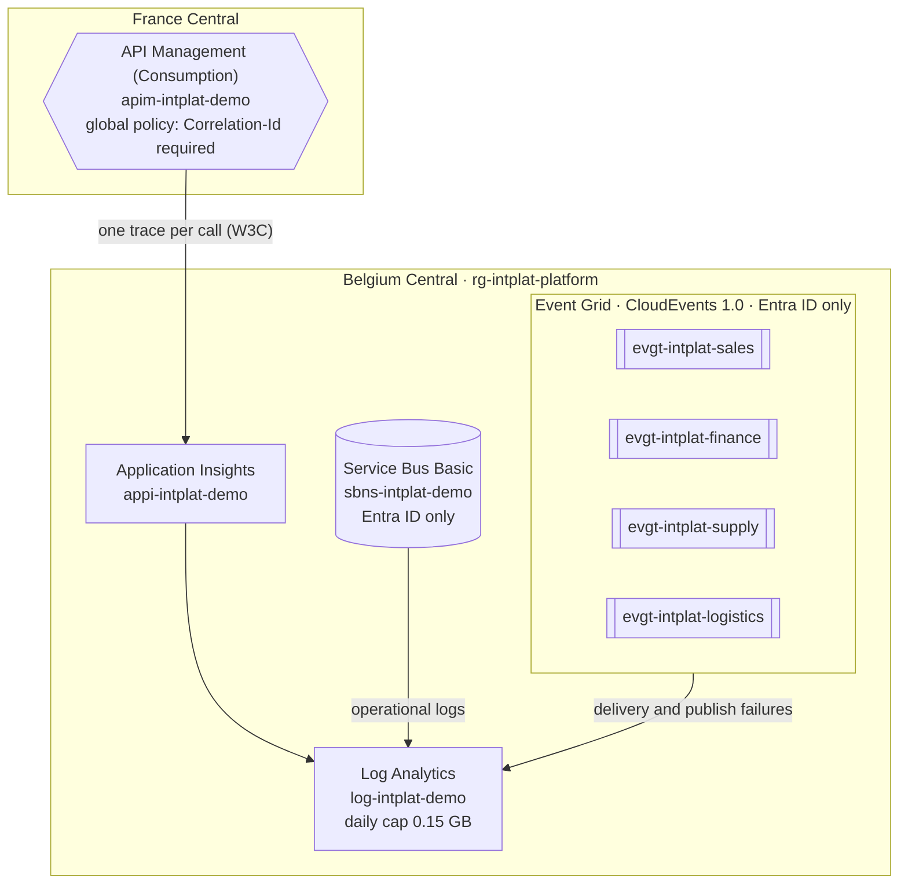

# integration-platform

The shared foundation of the
[AI Intelligence Domain demo](https://github.com/azure-intelligence-domain/ai-intelligence-domain)
integration platform. Owned by the **platform team**. Decision:
[ADR 0010](https://github.com/azure-intelligence-domain/ai-intelligence-domain/blob/main/docs/adr/0010-platform-core.md).

| Resource | Name | Notes |
|---|---|---|
| API Management | `apim-intplat-demo` | Consumption tier, France Central (not offered in Belgium Central). Every call traced to Application Insights with W3C correlation; `Correlation-Id` logged; client IPs not logged. |
| Event Grid topics | `evgt-intplat-<domain>` | One per business domain, CloudEvents 1.0 input schema, local auth disabled. |
| Service Bus | `sbns-intplat-demo` | Basic tier; one queue per subscriber (added with each consumer), local auth disabled. |
| Application Insights | `appi-intplat-demo` | Workspace-based. |
| Log Analytics | `log-intplat-demo` | 30-day retention, **daily cap 0.15 GB** (within the free 5 GB per month). |

## The gateway enforces the one rule

One global policy ([`infra/policies/global.xml`](infra/policies/global.xml)) applies to every
API, now and in the future: a call without a valid `Correlation-Id` gets
`400` [Correlation Id Required](docs/problems/correlation-id-required.md), and every response
echoes the `Correlation-Id`.

## [Platform] Health API

[`openapi.yaml`](openapi.yaml): answered by API Management itself, no backend. It exists to prove
the gateway, its policies and its tracing work after every deployment, and it follows the same
rules as every other API: adidas-checked contract, cataloged in EventCatalog.

## Pipeline

`.github/workflows/platform.yml`:

1. **Contract check** (reusable workflow from `contracts`): no contract, no deploy.
2. **Validate**: Bicep without warnings, policies well-formed XML.
3. **Deploy** (main only, OIDC as `id-intplat-platform`, rights on `rg-intplat-platform` only).
4. **Smoke test**: `200` HAL with the `Correlation-Id` echoed; `400` Problem Details without or
   with an invalid `Correlation-Id`; the call appears in Application Insights.

Secrets are never stored: the smoke-test subscription key is read at deploy time and masked.
